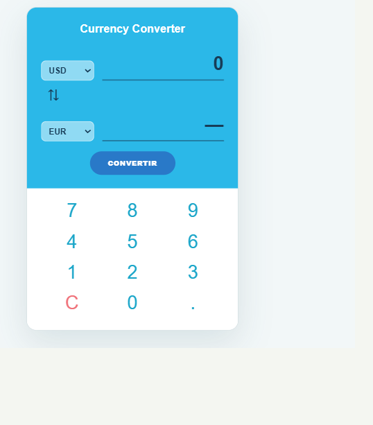

# Compte rendu — Convertisseur de devises

**Étudiant ou binôme :** à compléter  
**Technologies :** Vue 3, Composition API, TypeScript et Vite

## Présentation

L’application convertit un montant entre six devises au moyen de taux fixes fournis dans le sujet. L’interface comprend deux listes de devises, un bouton pour les inverser, un bouton de conversion et un clavier numérique intégré. La saisie au clavier physique est également prise en charge.

## Fonctionnement

Les devises et les taux sont définis dans `src/data/taux.ts`. Dans `src/components/CurrencyConverter.vue`, les références Vue conservent le montant, la devise source et la devise cible. Une propriété calculée convertit le montant en passant par l’euro et arrondit le résultat à deux décimales. Le résultat est actualisé quand le montant ou l’une des devises change.

Les listes sont générées avec `v-for` et liées avec `v-model`. Les touches du pavé numérique sont également générées avec `v-for`; leurs événements `@click` modifient le montant. Le bouton d’inversion échange les deux devises. La touche « C » réinitialise la saisie.

La saisie est limitée à dix caractères et à un seul point décimal. Une tentative de conversion avec un montant nul affiche un message d’erreur. La mise en page s’adapte aux écrans étroits.

## Captures d’écran

Les captures vérifiées sont également disponibles dans le dossier [`screenshots/`](../screenshots/).

### État au démarrage

### Cas de test

| Montant | Devise source | Devise cible | Résultat attendu | Capture |
|---:|:---:|:---:|---:|---|
| 120 | USD | EUR | 102.56 | [02-conversion-usd-eur.png](../screenshots/02-conversion-usd-eur.png) |
| 100 | EUR | TND | 340.00 | [03-conversion-eur-tnd.png](../screenshots/03-conversion-eur-tnd.png) |
| 50 | GBP | USD | 67.24 | [04-conversion-gbp-usd.png](../screenshots/04-conversion-gbp-usd.png) |
| 10 | EUR | EUR | 10.00 | [05-conversion-eur-eur.png](../screenshots/05-conversion-eur-eur.png) |

## Vérifications

- `npm run build` : vérification TypeScript et compilation de production réussies.
- Les quatre résultats du tableau ont été vérifiés dans le navigateur.
- L’inversion des devises, la saisie numérique, la limite de caractères et le message pour un montant nul ont également été testés.
